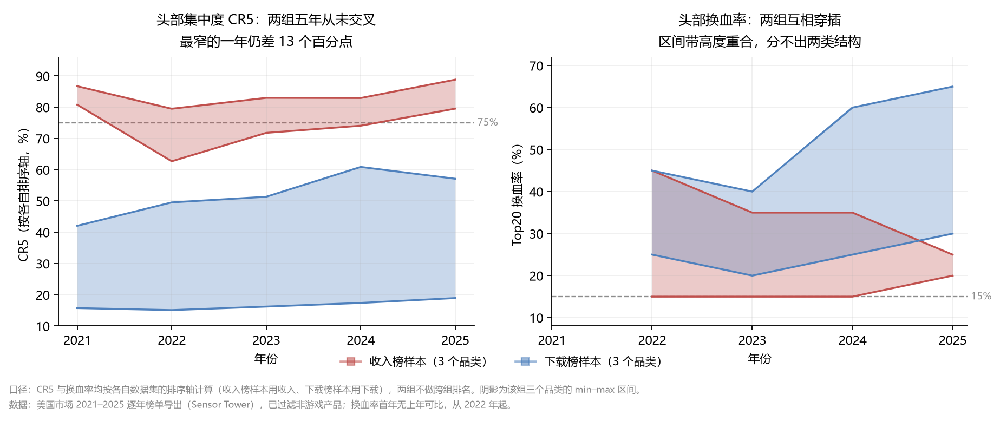

# 手游市场结构分析脚本

判断一个品类或题材**值不值得进入**——不是靠总量规模，而是靠市场结构：头部够不够固化、新品挤不挤得进去、靠什么变现、进来之后能活几年。这套脚本把这四问拆成可复算的指标。

字段含义见 [字段说明（fields.md）](fields.md)。

---

## Quick start

三个脚本按顺序跑，后一个依赖前一个的产出思路。跑之前各自改 `Config` 里的路径与维度。

```bash
# 1) 结构底表：先算齐集中度 / 吸量效率 / 新品 / 存量 / Top10
python genre_analysis.py                  # 改 Config.DATA_FOLDER / OUTPUT_FOLDER / DIMENSION

# 2) 趋势与判断：把逐年指标连成曲线，拆细分，落到「进 / 不进」
python market_structure_analysis.py       # 再改 RANK_AXIS，必须与该数据集的排序轴一致

# 3) 产品轨迹（可选）：用产品 ID 跨年追踪，回答「进来能活多久」
python cohort_tracking.py                # 同上
```

| 脚本 | 回答什么 | 输入 → 输出 |
|---|---|---|
| `genre_analysis.py` | 这个维度内的结构长什么样 | 榜单 csv × N → **5 张底表**（集中度 / 吸量效率 / 新品表现 / 存量产品表现 / Top10 产品详情）+ 2 张对比图 |
| `market_structure_analysis.py` | 结构在怎么变、细分在哪、要不要进 | 榜单 csv × N → **5 张底表**（产品模型分析 / 五年趋势 / 发行商与出海 / 市场分布 / 进入判断） |
| `cohort_tracking.py` | 进来之后能活几年 | 榜单 csv × N → **4 张底表**（队列进入率 / 头部留存 / 头部换血 / 存活者vs退出者） |
| `concentration_cr.py` | 多国多赛道的 CR 与 Top10 | 分析数据集 xlsx → 格式化 CR 报告（收入 / 下载两维度） |
| `lifecycle_classify.py` | 谁能长期在榜、谁只是短暂进榜 | 分析数据集 xlsx → 在榜产品明细 |

前三个吃的是**同一份榜单导出**；后两个吃的是另一份跨国家的合并分析数据集。

## 输入数据格式

前三个脚本读的是 Sensor Tower 导出的榜单明细 csv：

- **文件**：tab 分隔，UTF-16 编码（脚本对 UTF-8 / GBK 自动回退）；年份从 `Date` 列取，文件名里没有年份也能读。
- **目录**：把所有 csv 放进同一个目录即可，脚本会合并后按「维度 × 年份」逐组分析。
- **维度列**：跑品类用 `Game Sub-genre`，跑题材用 `Game Theme`（`Config.DIMENSION` 切换）。
- **`Config.RANK_AXIS` 必须与该数据集的排序轴一致**——收入榜导出填 `"revenue"`，下载榜导出填 `"downloads"`。配错会让被截断的那一侧总量被当成品类级结论（见下）。

核心列（前三个脚本）：

| 用途 | 列名 |
|---|---|
| 主键与名称 | `Unified ID`、`Unified Name` |
| 维度与标签 | `Game Sub-genre` / `Game Theme`、`Game Product Model`、`Category` |
| 时间 | `Date`、`Earliest Release Date` |
| 规模与变现 | `Downloads (Absolute)`、`Revenue (Absolute)`、`RPD (All Time, WW)`、`DAU (Absolute)`、`ARPDAU (Last Month, US)` |
| 增长 | `Downloads / Revenue (PoP Growth)`、`Downloads / Revenue (PoP Growth %)` |
| 发行商 | `Unified Publisher Name`、`Unified Publisher ID`、`Publisher Country` |
| 市场分布 | `Most Popular Country by Downloads` |

缺列会补空列并在日志里告警，但**维度列缺失会直接报错退出**——它是分析的主键。

`concentration_cr.py` / `lifecycle_classify.py` 读的是另一份合并分析数据集（xlsx），需要的列见各自章节。

---

## 数据边界与口径（先读这一节）

榜单导出的样本框决定了哪些结论能成立。这几条写在代码里，不靠人记。

1. **总量与份额只能用排序轴。** 榜单是「按某一个指标排序后导出的」，所以：按收入导出的样本里，总收入基本完整，但「高下载低收入」的纯广告产品被截断 ⇒ **它的下载量是系统性低估**；按下载导出的样本反之。另一轴只能出**样本内结构**结论（表里标 `sample_only`），不能当品类级。
   - 实测影响：Card Battler 2025 年的收入 CR5，在不过滤时是 83.0%，过滤后是 87.0%——差的 4 个百分点全在非游戏产品上。
2. **必须过滤 `Category != 'Games'`。** 实测下载榜样本里有 3.6% 的非游戏产品，而它们同样带着品类 / 题材标签，不滤会污染分母。
3. **跨年在榜一律用固定 Top N 排名口径**，不用「是否出现在导出文件里」——各年榜单深度逐年变化（实测 Block 的导出从 2021 年 1,641 行降到 2025 年 629 行），用文件出现与否会把「榜单变浅」误判成「产品掉榜」。
4. **DAU 只用于头部子样本**（覆盖率按下载五分位：最低档 8.9%、最高档 70%），不做主指标；ARPDAU 覆盖率 3%–15%，同理。
5. **不跨数据集拼接。** 每个导出各自跑，结论不跨集合并；产品 ID 只在同一个数据集内跨年有效。
6. **不把不同口径的维度排成一张座次。** 收入榜导出的品类与下载榜导出的品类分开呈现，各自内部可比。
7. **`RANK_AXIS` 配错会静默产生错误结论。** 它决定哪个轴可以出总量结论，配错不会报错，只会让被截断的那一侧看起来像真实总量。

---

## 1. genre_analysis.py — 品类 / 题材结构分析

**为什么需要**：集中度、分层增长贡献、新品渗透与变现、存量生命周期这些结构指标没法用透视表一次算出来，而它们须按「维度 × 年份」口径一致地批量计算，故写成脚本。

**做什么**（对每个维度 × 年份各算一遍）

- **集中度**：CR3 / CR5 / CR10 与垄断分层；头部 / 中腰部 / 尾部（40% / 70% 阈值）分层增长贡献；Top10 下载与收入双维度贡献；头部结构稳定性（前 3 名增长方差、第一二名差距、前 3 名成熟度）。
- **吸量效率**：分层吸量效率（下载 ÷ 产品数），及增长 / 留存 / 变现三个效率维度。
- **新品表现**：新品渗透率、增长贡献、RPD 溢价。
- **存量表现**：成熟（1–3 年）/ 衰退（3 年以上）分层，产品年龄与下载增长的 Pearson 相关。

**运行**：改 `Config.DATA_FOLDER` / `OUTPUT_FOLDER` / `DIMENSION` 后 `python genre_analysis.py`。

**输出**：`game_category_analysis_report_5years.xlsx`（5 张底表）+ CR5、吸量效率两张对比图。

**切换维度**：`Config.DIMENSION = "sub_genre"` 跑品类（读 `Game Sub-genre`），`"game_theme"` 跑题材（读 `Game Theme`）。其余口径与输出结构完全一致，输出里的维度列名随配置显示。

## 2. market_structure_analysis.py — 趋势、产品模型、进入判断

**为什么需要**：`genre_analysis.py` 每年独立算一套指标、每行 = 维度 × 年份，**五年趋势没有被读出来**；细分只靠品类标签也太粗，「进不进」的判断始终缺一个能落地的结构。

**做什么**（五张底表）

- **产品模型交叉**（细分识别）：用 Sensor Tower 官方标签 `Game Product Model`（超休闲 / 混合休闲 / 休闲 / 中重度）把维度拆开，看哪条商业化路径在长。
  - 为什么不用产品名做聚类：产品名测的是命名习惯，不是玩法——同一玩法会因命名习惯被拆成几个簇，不同玩法会因共用词被并到一起；再加上没有买量投入、曝光量、自然量/买量拆分这些数据，名字与表现之间的差异无法与产品质量、发行商预算区分。这类簇能回答「某个命名词占多少」，回答不了「这个品类分成哪几条赛道」。
  - 官方标签是平台方给的分类，可辩护，且直接对应商业化路径。实测区分度按维度而异：有的维度超休闲与休闲加起来九成、几乎没有中重度（走量），有的九成集中在中重度（路径单一）。
- **五年趋势**：维度 × 年份 × 指标（CR3/5/10、分层增长贡献、新品渗透、RPD、分层吸量效率），外加**两个基准列**——相对首年、相对同组中位。没有基准，趋势表只是一堆数；有了基准才能说「在恶化还是在好转」。
- **发行商与出海**：发行商集中度（Publisher CR3/CR5）、新进入者构成（新玩家 vs 老厂商跨界）、以及 `Most Popular Country by Downloads` 分布。
  - 最后一项回答一个很实的问题：榜单上跑得好的产品，有多少是**真靠本国市场**跑起来的（实测该字段与发行商国籍只有约 14% 一致，说明它记的是产品实际最畅销的市场）。
- **进入判断**：五个固定问题各出一行结论 + 依据 + 边界，合成「进 / 不进 / 有条件进」。

**进入判断的判定规则**

| 阈值 | 默认 | 判定含义 | 为什么是这个值 |
|---|---|---|---|
| `JUDGE_SCALE_RATIO` | 1.0 | 排序轴总量 ≥ 同组中位 × 该值 | 取 1.0 = 不要求比中位大，只要不在中位以下；跨口径维度不能比规模，基准限定在同一次运行内 |
| `JUDGE_GROWTH_MIN` | 0.0 | 首尾年 CAGR ≥ 该值 | 取 0 = 不要求增长、只要求不萎缩；用 CAGR 而非最近一年同比，避免被基数效应带偏 |
| `JUDGE_CR5_HIGH` | 75.0 | CR5 < 该值为集中度可接受 | Top5 拿走四分之三份额时，中小玩家已很难靠单点突破进入 |
| `JUDGE_CR5_VERY_HIGH` | 85.0 | CR5 ≥ 该值触发否决项 | 与上一档拉开 10 个点，区分「头部偏固」与「头部锁死」 |
| `JUDGE_CHURN_MIN` | 15.0 | 头部换血率 ≥ 该值为新品有空间 | 用换血率而非新品占比——新品占比高但头部固化时新品其实挤不进去；换血率直接测「头部位置是否对新进入者开放」 |
| `JUDGE_PATH_MIN_SHARE` | 50.0 | 最大产品模型档占比 ≥ 该值为路径清晰 | 过半才算「说得清靠什么赚钱」；同时说明可选项变少，这一层含义写在「变现依据」列 |

合成规则：**通过 ≥4 项且无否决 → 可进入；≥3 项 → 有条件进入；≤2 项 → 不建议进入。** CR5 超过 `JUDGE_CR5_VERY_HIGH` 触发否决项，综合判断封顶为「有条件进入」。

阈值全部在 `Config` 里，输出表的**「判定规则」列会自动带上本次运行的实际取值**——改阈值不用回来改文档。

**运行**：改 `Config.DATA_FOLDER` / `OUTPUT_FOLDER` / `DIMENSION` / `RANK_AXIS` 后 `python market_structure_analysis.py`。

**输出**：`市场结构分析_<维度>_<排序轴>_<时间戳>.xlsx`。

## 3. cohort_tracking.py — 产品轨迹：进入头部、留存与换血

**为什么需要**：榜单数据最独特的能力是**用产品 ID 跨年追踪同一个产品怎么起怎么落**，而这个能力不用就浪费了。「值不值得进」里最实的一问是「进来之后能活几年」。

**做什么**（四张底表）

- **队列进入率**：按首发年份分队列，看第 k 年有多少成员进入头部 Top N。
  - ⚠ 指标命名：它测的是「新品进入头部的比例」，**不是存活率**——队列成员从未被要求先进过 Top N。
  - 两个必须知道的偏误：分母是**当年进榜的新品**（不是当年全部新品）⇒ 结果偏乐观；**上线当年（k=0）在收入轴下结构性吃亏**——新游当年几乎没有收入，进不了当年收入 Top N，到第二年才有完整年度数据，所以 k=0 与 k≥1 不可直接比较。
- **头部留存**：真正的存活口径——**在首个完整经营年进入 Top N 的新品，次年还能不能保住位置**。避开「上线当年进不了榜」的干扰。
- **头部换血**：每年 Top20 里有多少是上一年不在的，换血产品里有多少是当年新品。首年无上年数据，留空而不是记成 100%。
- **存活者 vs 退出者**：把队列按次年是否仍在榜分成两组，对比它们在**进入年**的下载规模、RPD、产品模型档、发行商规模。

**运行**：改四个 `Config` 后 `python cohort_tracking.py`。

**输出**：`产品轨迹分析_<维度>_<排序轴>_<时间戳>.xlsx`。

---

## 4. concentration_cr.py — CR 集中度与 Top10 底表

服务多国 × 多赛道 × 多年份的下载 / 收入集中度对比。手工透视容易口径不一，脚本统一处理：下载 CR 按下载排名、收入 CR 按收入排名分别取值；CR 基数按品类切换（产品少的品类取 4，其余取 5）；当年首发的产品标黄；收入与下载两个维度各出一张表。

**运行**：把合并好的分析数据集 xlsx 放到 `data/analysis_dataset.xlsx`，需含 `Unified Name` / `Game Sub-genre` / 国家 / 年份 / `Downloads (Absolute)` / `Revenue (Absolute)` / `Earliest Release Date` 列。

**输出**：`data/RPG手游市场分析报告.xlsx`。

## 5. lifecycle_classify.py — 跨年榜单分类

判断哪些产品能长期留在品类 Top20、哪些只是短暂进榜。在榜标准是当年在本品类内下载或收入任一进入 Top20，分「始终在榜（上市以来每个有数据年份都在榜）/ 曾经在榜 / 从未在榜」三类，保留始终与曾经在榜产品并附逐年排名。

**运行**：同上格式的分析数据集。

**输出**：`data/在榜产品分析_按品类排名.xlsx`。

---

## 6. 实测结果

### 数据与范围

| 数据集 | 排序轴 | 维度 | 覆盖 | 逐年产品数 |
|---|---|---|---|---|
| 收入榜导出 | 收入 | Card Battler / Match Merge 2 / Real-Time Strategy | 美国，2021–2025 | 1,512–2,983 |
| 下载榜导出 | 下载 | 4X Strategy / Block / Solitaire | 美国，2021–2025 | 2,259–5,159 |

数据是 Sensor Tower 双平台应用排行榜的逐年导出（美国），已按 `Category = 'Games'` 过滤。另跑了 10 个题材维度（下载轴），但题材的作用是吸量、口径与品类不同，不与品类并列，故不进本节结论。各小节分别出自哪个脚本、哪张表，见本节末「这些数字从哪来」。



图由仓库里的 `make_readme_figures.py` 从这两份产出表直接生成，不另算指标。

### ① 集中度上两组泾渭分明，换血率上分不开

2025 年按各自排序轴算的 CR5：收入轴 Card Battler 87.0%、Real-Time Strategy 88.8%、Match Merge 2 79.5%；下载轴 Block 57.1%、4X Strategy 43.0%、Solitaire 19.0%。五年里两组**一次都没有交叉**——最窄的 2022 与 2024 都还差 13.2 个百分点，最宽的 2021 差 38.7 个百分点。

换血率没有这种分界。Card Battler 常年 15%–20%，看着很固；但 Match Merge 2 是 25%–45%，高于下载轴的 4X Strategy（20%–30%），Block 则是 30%–65%。所以「变现型守位置、流量型换位置」**只有前半截成立**：收入轴的集中度确实高一档，但头部流动性不是两类结构的稳定标签——能说的是「流量型头部换人更频繁」，不能说两者是两种形态。

### ② 头部固化伴随头部留存下滑——但只有一个案例撑得住

在首个完整经营年进入 Top100 的新品，次年还能保住位置的比例：Card Battler 73.3% → 61.5% → 46.7%（2022–2024 观察年），Real-Time Strategy 73.9% → 60.0% → 68.4%，Match Merge 2 48.8% → 54.1% → 45.5%。

只有 Card Battler 是单调下滑，另两个（同属收入轴）是波动，谈不上趋势。而且这三条队列每年只有 13–15 个产品——一条 15 个样本的比率线，少保住 4 个产品就掉 27 个百分点。

下载轴的三个品类跑了同一张表，方向更乱：4X Strategy 66.7% → 63.6% → 35.7%、Block 33.3% → 70.0% → 50.0%、Solitaire 60.0% → 36.4% → 66.7%。**六条队列没一条能当趋势外推，只能当方向。**

### ③ 一个品类靠什么赚钱，标签分布直接给答案

2025 年按产品数占比：Solitaire 95.1% 是休闲；4X Strategy 91.7% 是中重度；Card Battler 81.1%、Real-Time Strategy 67.4% 也以中重度为主；Block 是休闲 63.3% 加超休闲 31.2%；Match Merge 2 是超休闲 52.5% 加休闲 39.5%，中重度只剩 2.1%。

六个品类里五个有单一模型档占六成以上，其中两个超过九成；唯一的例外（Match Merge 2）是两个轻量档合计九成、几乎没有中重度。变现路径不用猜，标签分布就写着。

### ④ 进入判断：四个可进入、两个被集中度封顶

| 品类 | 样本 | 通过项 | 否决项 | 判断 |
|---|---|---|---|---|
| Match Merge 2 | 收入轴 | 4/5 | 无 | 可进入 |
| 4X Strategy | 下载轴 | 5/5 | 无 | 可进入 |
| Block | 下载轴 | 4/5 | 无 | 可进入 |
| Solitaire | 下载轴 | 5/5 | 无 | 可进入 |
| Card Battler | 收入轴 | 3/5 | CR5 87.0%，头部固化且仍在上升 | 有条件进入 |
| Real-Time Strategy | 收入轴 | 4/5 | CR5 88.8%，头部固化且仍在上升 | 有条件进入 |

Real-Time Strategy 五项里过了四项，只因 CR5 越过否决线被封顶；Card Battler 除否决项外，规模也只有同组中位的 0.90 倍。

> 这些结论的适用范围就是这两份导出的覆盖范围——不是全市场，换一份导出要重跑。

### 这些数字从哪来

| 小节 | 脚本 | 产出 | 用到的表 / 列 |
|---|---|---|---|
| ① 集中度与换血率 | `market_structure_analysis.py` | `市场结构分析_*.xlsx` | 「五年趋势」的 `CR5_<排序轴>` 与 `头部换血率%` 两列 |
| 图 | `make_readme_figures.py` | 同上，收入轴与下载轴各一份 | 只读「五年趋势」的这两列，不重算任何指标 |
| ② 头部留存 | `cohort_tracking.py` | `产品轨迹分析_*.xlsx` | 「头部留存」的 `头部留存率%` |
| ③ 产品模型 | `market_structure_analysis.py` | `市场结构分析_*.xlsx` | 「产品模型分析」的 `产品数占比%`，取 2025 年 |
| ④ 进入判断 | `market_structure_analysis.py` | `市场结构分析_*.xlsx` | 「进入判断」全表，含 `判定规则` 与 `适用边界` 两列 |

三个脚本都直接读榜单 csv，彼此不依赖中间文件。

§6 只用了 `market_structure_analysis.py` 与 `cohort_tracking.py` 合计 9 张底表里的 4 张。没进来的：`genre_analysis.py` 的 5 张底表与 2 张对比图（它的逐年指标在「五年趋势」里已按同一口径重算，不重复引）、「五年趋势」的其余十多列、「发行商与出海」、「市场分布」，以及 `cohort_tracking.py` 的「队列进入率」「头部换血」「存活者 vs 退出者」。

## 依赖

```
pandas
numpy
openpyxl
matplotlib      # genre_analysis.py 的对比图、make_readme_figures.py
```

## 关于示例值

仓库代码中的输入输出路径均为占位示例值，替换成实际路径即可运行，业务逻辑与统计口径完整保留。代码不含公司内部数据、市场明细数据或未公开的结论；README 里的指标均为品类级聚合（CR5、换血率、产品模型占比），不含单品级份额。