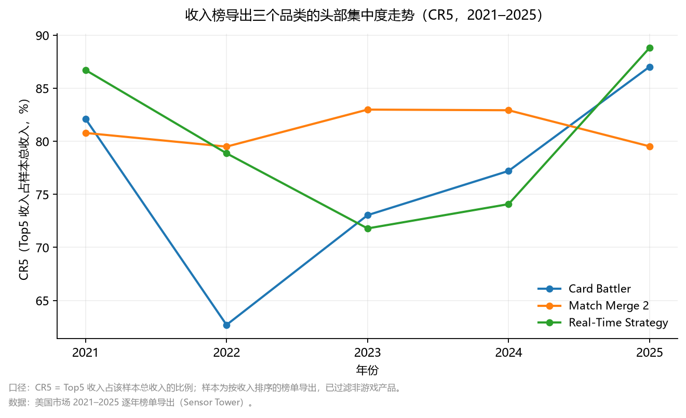

# 手游市场结构分析工具

**项目状态：可运行。** 前三个脚本读榜单导出，后两个读合并分析数据集；仓库不含数据，运行前需自备同格式文件。

## 项目简介

本项目用 Python 处理手游榜单导出数据，计算品类与题材的集中度、产品分层、新品表现、产品模型分布、发行商结构与跨年留存，输出 Excel 底表与图表。

分析对象是榜单样本内的结构，不是全市场总量。能支撑什么结论、不能支撑什么，见「数据限制与已知问题」。

## 使用场景

- 比较不同品类或题材的头部集中度与头部换手
- 看新品进入头部后还能留在榜上多久
- 按产品模型（超休闲 / 混合休闲 / 休闲 / 中重度）拆解一个维度的构成
- 多国、多赛道的 CR 与在榜产品对照

## 功能说明

| 脚本 | 功能 | 输入 | 输出 | 依赖 | 限制 |
|---|---|---|---|---|---|
| `genre_analysis.py` | 维度内结构：集中度、分层增长贡献、新品与存量表现、吸量效率 | 榜单 csv × N | 5 张底表 + 2 张对比图 | pandas / numpy / openpyxl / matplotlib | 各年需分别导出；维度列缺失直接退出 |
| `market_structure_analysis.py` | 五年趋势、产品模型交叉、发行商与出海 | 榜单 csv × N | 5 张底表 | pandas / numpy / openpyxl | `RANK_AXIS` 配错不报错，结论会错 |
| `cohort_tracking.py` | 队列进入率、头部留存、头部换血、存活者与退出者对比 | 榜单 csv × N | 4 张底表 | 同上 | 队列分母是「当年进榜新品」，结果偏乐观 |
| `concentration_cr.py` | 多国多赛道 CR 与 Top10 | 合并分析数据集 xlsx | 收入 / 下载两张 CR 表 | 同上 | CR 基数按品类切换（4 或 5），跨品类不可直接比 |
| `lifecycle_classify.py` | 跨年榜单分类：始终 / 曾经 / 从未在榜 | 合并分析数据集 xlsx | 在榜产品明细 | 同上 | 以 `Unified ID` 为主键；缺该列退回名称并告警 |

## 技术栈

| 技术 | 用途 |
|---|---|
| Python 3 | 批量处理榜单 csv |
| pandas / numpy | 数据清洗与分组计算 |
| openpyxl | 写出 xlsx 底表 |
| matplotlib | `genre_analysis.py` 的对比图与 README 配图 |

## 输入数据与配置

榜单导出为 tab 分隔 CSV，UTF-16 编码（脚本对 UTF-8 / GBK 自动回退）。把各年文件放进同一目录即可，年份从 `Date` 列取，不依赖文件名。

必配项：`Config.DATA_FOLDER`（数据目录）、`Config.OUTPUT_FOLDER`（需已存在）、`Config.DIMENSION`（`sub_genre` 读 `Game Sub-genre`，`game_theme` 读 `Game Theme`）、`Config.RANK_AXIS`（收入榜填 `revenue`，下载榜填 `downloads`）。

核心列：`Unified ID` / `Unified Name`、维度列、`Game Product Model`、`Category`、`Date`、`Earliest Release Date`、`Downloads (Absolute)`、`Revenue (Absolute)`、`RPD (All Time, WW)`、`DAU (Absolute)`、`ARPDAU (Last Month, US)`、发行商三列、`Most Popular Country by Downloads`。缺列会补空列并在日志告警；维度列缺失直接报错退出。

## 处理流程

1. 读取目录内全部 csv，合并后按「维度 × 年份」分组
2. 每组过滤 `Category != 'Games'`，按产品主键计算指标
3. 结果写成 xlsx（每组一行或一张表）与图表
4. `market_structure_analysis.py` 额外做跨年对齐、产品模型交叉与发行商维度

## 安装和运行

```bash
pip install -r requirements.txt

python genre_analysis.py             # 结构底表（先改 DATA_FOLDER / OUTPUT_FOLDER / DIMENSION）
python market_structure_analysis.py  # 趋势、产品模型、发行商（再改 RANK_AXIS）
python cohort_tracking.py            # 跨年留存（可选）
```

`concentration_cr.py` 与 `lifecycle_classify.py` 读 `data/analysis_dataset.xlsx`，路径写在各自文件末尾。

## 指标说明

字段、计算方式与输出结构见 [fields.md](fields.md)。

其中两项是描述性辅助指标，不用于判断：`downloads_growth_per_launch_day`（上线期间日均下载增量）、`acquisition_dau_downloads_ratio`（DAU ÷ 累计下载量，不是用户留存率）。

## 数据限制与已知问题

1. **总量与份额只能用排序轴。** 按收入导出的样本在收入维度覆盖较全，另一轴只能出样本内结论（表里标 `sample_only`）。CR 的分母是导出样本，不等于整个品类市场。
2. **必须过滤 `Category != 'Games'`**，否则非游戏产品会进分母，而它们同样带品类与题材标签。
3. **跨年在榜用固定 Top N**，不用「是否出现在导出文件里」——各年榜单深度差异很大。
4. **不跨数据集拼接**，产品 ID 只在同一数据集内跨年有效。

完整口径与实测影响见 [docs/data_limits.md](docs/data_limits.md)。

已知问题：

- 五个判定阈值（规模、增长、CR5 两档、换血率、路径集中度）是经验设定，未经历史数据校准，也未做跨市场验证
- 只在 Windows 单机、单一数据提供商的导出上跑过；换数据源需重新核对列名与编码
- 仓库不含原始数据，他人无法复现文中数值

## 实测结果

本节只展开收入榜导出的三个品类（Card Battler / Match Merge 2 / Real-Time Strategy），美国 2021–2025，逐年 1,512–2,983 个产品，已过滤非游戏。下载榜与题材跑同一套脚本，口径不同，不并列。



图由 `make_readme_figures.py` 从产出表生成，不重算指标。

**集中度**：2025 年 CR5 为 Real-Time Strategy 88.8%、Card Battler 87.0%、Match Merge 2 79.5%；五年最低是 Card Battler 2022 年的 62.7%。走势分三种——Card Battler 2022 回落后逐年升到 87.0%，Real-Time Strategy 2023 触底 71.8% 后回升，Match Merge 2 五年在 79.5%–83.0% 走平。

**换血率**：Top20 换血率 Card Battler 15%–20%、Real-Time Strategy 25%–35%、Match Merge 2 25%–45%。Match Merge 2 的 CR5 与另两个相差不到十个点，头部换得更勤。

**产品模型**：2025 年按产品数，Card Battler 81.1%、Real-Time Strategy 67.4% 以中重度为主；Match Merge 2 是超休闲 52.5% 加休闲 39.5%，中重度只占 2.1%。标签反映的是产品模型结构，内购与广告的实际构成需要变现数据。

**头部留存**：首个完整经营年进入 Top100 的新品，次年保住位置的比例：Card Battler 73.3% → 61.5% → 46.7%，Real-Time Strategy 73.9% → 60.0% → 68.4%，Match Merge 2 48.8% → 54.1% → 45.5%（2022–2024 观察年）。每条队列每年只有 13–15 个产品，少保住 4 个就掉 27 个百分点，只能当方向看。

## 项目目录

```
genre_analysis.py             结构底表
market_structure_analysis.py  五年趋势、产品模型、发行商
cohort_tracking.py            跨年留存
concentration_cr.py           多国 CR
lifecycle_classify.py         在榜分类
fields.md                     字段与指标口径
make_readme_figures.py        README 配图
docs/data_limits.md           完整数据口径与实测影响
docs/figures/                 README 图片
```

## 数据来源

2021–2025 年美国市场的 Sensor Tower 双平台应用排行榜逐年导出，每年一份，文件内 `Date` 列标记该年 1 月 1 日，已按 `Category = 'Games'` 过滤；题材维度使用下载榜导出。2025 年文件覆盖该自然年全年，导出时间不早于 2026 年，具体导出日期未记录。

原始数据受提供商授权限制，不随仓库发布，代码中的输入输出路径均为占位示例值。具体数值随导出深度与时间变化，复现需自备同格式数据。
